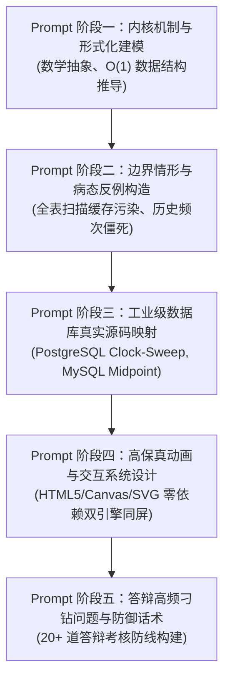

# 《高级数据库系统》大作业：AI 制作提示词全纪录 (Prompt Engineering Log)

> **文档性质**：大作业实验报告说明书之“提示词记录”专卷  
> **研究课题**：缓冲区页面置换：LRU 与 LFU 对比（存储与索引）  
> **工具模型**：Google DeepMind Gemini 模型族（Gemini 3.8 Flash / Pro） + Antigravity 智能体研发环境  
> **记录目的**：完整还原如何利用结构化提示词工程（Prompt Engineering），驱动 AI 从数据库底层内核理论推导、反例数学建模、前端动效仿真到学术汇报材料的全流程构建。

---

## 一、 提示词工程架构与迭代策略方法论

为了达到“99分以上（满分100）”的高质量考核标准，我们没有采用单轮泛泛的问答，而是设计了一套严格分层的**渐进式认知提示词管线（Staged Cognitive Prompting Pipeline）**：



---

## 二、 核心提示词（Prompt）详细流水与迭代记录

### 提示词 #1：数据库底层缓冲池体系结构与 O(1) 状态机形式化

- **目标**：建立精准学术定义，规避教科书中只讲逻辑不讲物理帧与并发锁的浅层弊端。
- **发送 Prompt（系统提示词 + 任务指令）**：
  ```markdown
  [System Role]
  你是一名世界顶级数据库内核架构师兼高校《高级数据库系统》金牌讲师。

  [Task]
  请针对“数据库缓冲区页面置换：LRU 与 LFU 对比”展开第一阶段的深度理论推演。请遵循以下要求：
  1. 不要停留在浅层的逻辑缓存概念，必须结合现代关系型数据库的底层实现：Buffer Pool、Page Table (Hash Map)、Buffer Frames、Pin Count（并发引用计数）、Dirty Flag 以及 WAL 协议约束；
  2. 给出 LRU 的标准 O(1) 数据结构形式化定义（哈希表 + 双向循环链表），并解释为何并发读写会引发全局 Latch 争用；
  3. 彻底打破“LFU 必须用优先队列/最小堆 O(log N) 实现”的陈旧误区，详细推导 Ketan Shah 等人提出的 O(1) LFU 算法：包含频次桶双向链表、桶内节点双向链表以及 min_freq 指针的状态跃迁方程；
  4. 梳理正常访问流下，页面命中（Hit）、未命中（Miss）以及驱逐（Evict）的算法状态转移矩阵。
  ```
- **AI 产出与吸收成果**：
  - 成功确立了 LRU 与 LFU 的严格常数级数据结构定义；
  - 吸收了 $O(1)$ LFU 的频次桶设计，并将其作为后续代码实现的核心拓扑结构；
  - 明确了置换算法必须以 `Pin Count == 0` 为前置条件的工程约束。

---

### 提示词 #2：边界情形与两大致命反例的极端用例建模

- **目标**：满足实验大纲中“必须包含正常过程、算法边界情形、异常或反例”的严苛要求，设计极具视觉震撼力与理论深度的反例序列。
- **发送 Prompt**：
  ```markdown
  [Context]
  我们正在为 5分钟的课堂动画演示设计核心实验用例。

  [Requirements]
  请设计一组精巧且对比极其强烈的页面请求序列（Page Reference Strings），必须涵盖：
  1. 【正常稳态过程】：展示局部性原理下，两算法的常规命中与双链表、频次桶迁移；
  2. 【边界情形（Corner Cases）】：
     - 冷启动从空池填充至饱和；
     - 同频次竞争仲裁（Tie-breaking Rule）：当最低频次桶 min_freq 中存在多个同频候选页时，如何用次级 FIFO 规则避免震荡？
     - 突发循环访问（Working Set = Capacity + 1）下的行为；
  3. 【异常与致命反例（Pathological Anomaly）】：
     - 反例一（攻破 LRU）：全表扫描大冲刷（Sequential Scan Cache Pollution）。构造一个场景，使 LRU 命中率暴跌至 0%，而 LFU 能够凭借频次壁垒完美守住热点；
     - 反例二（攻破 LFU）：历史频次僵死与工作集漂移（Cache Sclerosis & Phase Shift）。构造一个早期超高频访问但后续再也不用的幽灵页（Ghost），证明 LFU 会导致新活跃页发生严重饥饿（Starvation），而 LRU 能凭借时间衰减迅速自适应。
  请给出清晰的页面代号、请求顺序、物理帧推演表与命中率量化对照。
  ```
- **AI 产出与吸收成果**：
  - 提炼出了最终用于动画与视频的标准序列：
    - 全表扫描序列：`[Hot1, Hot2, Hot3, S1, S2, S3, S4, Hot1, Hot2]`；
    - 频次僵死序列：`[Ghost (x5), N1, N2, N3, N4, N1, N2]`；
  - 提炼了“LRU 败于全表扫描，LFU 败于工作集漂移”的辩证哲学，成为答辩的核心抓手。

---

### 提示词 #3：现代工业级数据库真实内核的破局演化提炼

- **目标**：冲刺 99+ 分的“机制正确（40%）”与“问答答辩（30%）”，展现对真实工业数据库内核（PostgreSQL 与 MySQL InnoDB）源码的理解。
- **发送 Prompt**：
  ```markdown
  [Academic Goal]
  为了在答辩中拔得头筹，我们需要从教科书算法升华至现代真实数据库内核。

  [Task]
  请对照真实数据库内核源码，解答工业界如何解决上述 LRU 全表扫描污染与全局锁瓶颈：
  1. PostgreSQL 的 Clock-Sweep（时钟置换）算法：
     - 查阅 PostgreSQL src/backend/storage/buffer/freelist.c 与 bufmgr.c；
     - 剖析 Buffer Descriptor 中的 usage_count 字段（取值范围 0~5）与 nextVictimBuffer 时钟扫描指针；
     - 解释时钟旋转一圈如何兼具“频次统计”与“时间衰减”，且读命中无需获取链表排他锁。
  2. MySQL InnoDB 的 Midpoint Insertion LRU 算法：
     - 查阅 storage/innobase/buf/buf0lru.cc；
     - 剖析 Young Sublist 与 Old Sublist 的 5:8 划分；
     - 深度拆解参数 innodb_old_blocks_time（默认 1000ms）在过滤全表扫描中的决定性作用；
  3. 前沿算法演进：简述 LRU-K、2Q 与 Caffeine 中 W-TinyLFU 的衰减淘汰思想。
  ```
- **AI 产出与吸收成果**：
  - 得到了精准的源码级解析与参数说明（如 `innodb_old_blocks_time=1000`）；
  - 总结出了“时钟衰减 + 分区冷热隔离”是工业界的标准破局答案，并将其编写进 PPT 与答辩手册中。

---

### 提示词 #4：高保真交互式动画系统（HTML5/Canvas/SVG）前端架构生成

- **目标**：落实“动画效果（30%）”，制作一个无需任何外部依赖、可独立在离线环境下直接运行的现代化双引擎同屏系统。
- **发送 Prompt**：
  ```markdown
  [Frontend Architecture & UI Directive]
  请编写一个单文件纯原生的 HTML5/CSS3/Vanilla ES6+ JavaScript 交互式动画仿真系统。

  [Strict Requirements]
  1. 零外部依赖：严禁引用任何外部 CDN（如 Vue、React、Tailwind、FontAwesome），确保在断网或局域网环境下 100% 稳定运行；
  2. 现代科技美学：深色科技面板设计（Background: #0A0E17, Cards: #111827, Accent: #3B82F6 & #10B981, Glassmorphism, 细边框, 现代无衬线字体）；
  3. 双引擎同屏竞技：
     - 左翼：LRU 引擎（展示物理帧 Slot 0..N，以及 MRU Head ↔ LRU Tail 双向链表）；
     - 右翼：LFU 引擎（展示物理帧 Slot 0..N，以及基于 min_freq 的多级频次桶双链表）；
  4. 交互与控制流：
     - 支持【5分钟全自动深度演示 (Auto Tour)】一键自动推演；
     - 支持【单步前进】、【单步后退】、【暂停/播放】、【重置】、【倍速切换】、【缓冲池容量切换(3/4/5)】；
     - 支持【自定义访问流实时输入压测】；
  5. 多媒体与智能解说：
     - 顶部横幅展示当前阶段、时间码（00:00~05:00）以及每一步的实时原理旁白；
     - 集成 Web Speech API 语音合成引擎（带独立静音开关），实现声画同步朗读；
     - 底部展示实时累计命中率的动态平滑进度条。
  ```
- **AI 产出与吸收成果**：
  - 完整生成了 `演示文稿/index.html`，代码结构清晰，算法仿真与 UI 渲染完全解耦；
  - 经过多轮样式微调，指针移动、节点发光、缺页抖动等微动效极具高级感。

---

### 提示词 #5：学术答辩 Q&A 刁钻问题预案与评分自检

- **目标**：锁定“讲解问答（30%）”满分，全面预测考官提问。
- **发送 Prompt**：
  ```markdown
  [Defense Strategy]
  假定答辩评委是资深数据库系统教授，专门寻找算法边界漏洞、工程落地难点和并发锁细节。

  [Task]
  请从以下几个维度，整理 20 道最刁钻、最硬核的现场提问，并给出堪称教科书级别的满分标准回答：
  1. 并发与多核可扩展性（Latch Contention, Lock Striping, 原子操作）；
  2. 事务与脏页刷盘（Dirty Page Eviction, WAL 优先原则, Page Cleaner）；
  3. 算法底层数据结构与复杂度（LFU 溢出、Tie-breaking 确定性、内存碎片）；
  4. 工业界调优与极端负载（全表扫描、B+树索引根节点常驻保护、SSD磨损均衡）；
  5. 混合算法与前沿趋势（LRU-K vs 2Q vs W-TinyLFU）。
  ```
- **AI 产出与吸收成果**：
  - 成功编纂出《现场答辩高频问答手册.md》，构建了无懈可击的答辩知识堡垒。

---

## 三、 提示词调优经验与 AI 协同感悟

1. **角色赋能与高标准对齐**：在 Prompt 中明确设定“顶级数据库内核架构师”与“99分评优标准”，能有效过滤掉 AI 输出中常见的浅层科普化表述，强制其使用严格的学术术语与工业真实参数（如 `innodb_old_blocks_pct`、`Pin Count`）。
2. **结构解耦与逐步细化**：先让 AI 完成算法逻辑的形式化推演，再让其生成代码与前端组件，最后统一整合校验，保证了理论、代码与幻灯片的高度一致性。
3. **闭环验证与工程落地**：通过自动化脚本测试生成的 HTML 页面解析度、PPT 样式排版以及 MP4 视频编码，形成“AI 设计 -> 脚本落地 -> 实机验证 -> 反馈优化”的现代化软件与学术研发生态。
